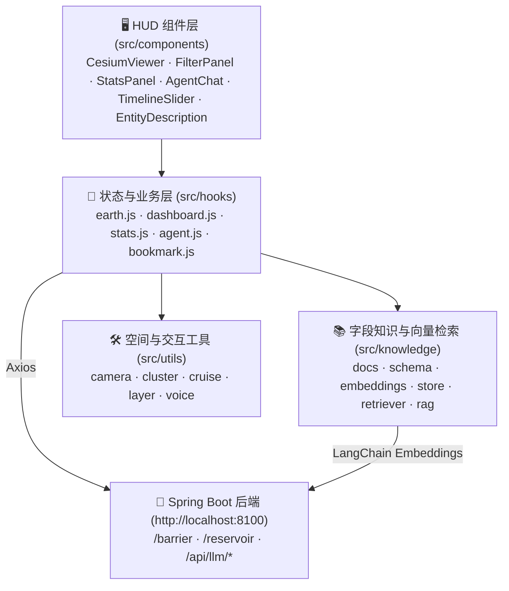

<div align="center">

# 🌍 Global Dam Watch Visualization — Frontend

**全球大坝与水库三维可视化系统 · 前端应用**

> 🎓 **武汉科技大学 · 计算机科学与技术学院 · 2026 届本科毕业设计代码**

[](#项目背景)

[](https://vuejs.org/)
[](https://cesium.com/)
[](https://vitejs.dev/)
[](https://element-plus.org/)
[](https://echarts.apache.org/)
[](https://js.langchain.com/)

[✨ 功能全景](#-功能全景) · [🏗️ 前端架构](#️-前端架构) · [🚀 快速开始](#-快速开始) · [🧭 操作指南](#-操作指南) · [📁 目录结构](#-目录结构)

</div>

---

## 🎓 项目背景

> [!NOTE]
> 本仓库为 **武汉科技大学计算机科学与技术学院 2026 届本科毕业设计** 的前端可视化与智能体交互源码。  
> 应用基于 **Vue 3 + CesiumJS + ECharts + LangChain** 构建，以三维数字地球为核心载体，将全球大坝点位、水库多边形、多维条件筛选、统计分析图表、实体对比、水库环湖巡航、时间轴演进与 **RAG 驱动的 GIS 智能体** 无缝融合在同一套大屏 HUD 界面中。

---

## ✨ 功能全景

| 分类 | 核心能力 |
| :--- | :--- |
| 🌏 **三维地球与底图** | 基于 CesiumJS 加载大坝点实体与水库多边形实体，支持独立显隐、重载与智能聚簇；内置 **ArcGIS World Imagery**、**USGS Imagery Only**、**Sentinel-2 Cloudless 2024** 三源高清影像底图自由切换 |
| 🎯 **条件筛选与同步** | 支持在大坝与水库间一键切换，按流域、用途、数据质量、建成年份、国家/地区及坝高、库容、面积等数值区间精细筛选，并实时同步渲染至三维地球 |
| 📊 **多维统计与导出** | 内置 ECharts 6 展示 **6 组多维占比图表**；支持将地图同步后的实体导出为 **CSV** 数据表，或按图表逐张导出高清 **PNG** 图片 |
| 🔎 **实体详情与对比** | 点击地球上的任意大坝或水库即可查看完整工程属性、快速飞行聚焦，并支持选取两个同类型实体进行并排属性对比 |
| 🚤 **水库环湖绕行** | 围绕水库边界自动生成闭合巡航轨迹，驱动 3D 小船模型 (`Boat.glb`) 沿湖岸动态绕行浏览 |
| ⏳ **建设历程回放** | 内置时间轴控制器，按建成年份动态演进全球大坝/水库建设历程，支持播放、暂停、重置及多档倍速调节 |
| 🔖 **视角书签管理** | 一键保存当前筛选条件与三维相机姿态至浏览器 `localStorage`（`gdw-bookmarks`），随时快速复现分析现场 |
| 🤖 **GIS 智能体 & RAG** | 基于规则意图路由区分**实体定位**、**自然语言条件筛选**与**领域问答**，结合本地字段知识库向量检索（RAG）与 LangChain 工具调用，实现自然语言操控三维地球 |
| 🎙️ **语音交互与坐标 HUD** | 支持基于 Web Speech API 的中文语音输入；界面底部实时显示鼠标经纬度、相机海拔高度与视角参数 |

---

## 🏗️ 前端架构



---

## 🛠️ 技术栈

| 类别 | 技术选型 | 说明 |
| :--- | :--- | :--- |
| **前端框架** | Vue `3.5` (`<script setup>`) | 组合式 API 响应式架构 |
| **工程构建** | Vite `5.4` + `@vitejs/plugin-vue` `6` | 极速热更新与生产打包 |
| **三维引擎** | CesiumJS `1.121` + `vite-plugin-cesium` | 三维地球渲染、实体聚簇、轨迹巡航 |
| **界面组件** | Element Plus `2.13` + Icons | 暗色大屏 HUD 交互控件 |
| **数据可视化** | ECharts `6.0` | 多维统计图表与 PNG 导出 |
| **AI 智能体** | LangChain `0.3` + `@langchain/openai` + Zod | 意图路由、工具调用与内存向量 RAG |
| **网络与测试** | Axios `1.7` / Node.js Test Runner | REST 通信与巡航算法单元测试 |

---

## 📋 运行要求

- **Node.js**：`^20.19.0` 或 `>=22.12.0`（`@vitejs/plugin-vue` 6 的版本要求）
- **包管理器**：npm
- **浏览器**：支持 WebGL 的现代桌面浏览器（Chrome / Edge 推荐）
- **后端服务**：配套 Spring Boot 后端已启动并运行于 `http://localhost:8100`
- **网络环境**：可访问 ArcGIS、USGS 或 EOX 公网影像瓦片服务

> [!TIP]
> 语音输入为增强能力，依赖浏览器的 Web Speech API 支持及麦克风权限，不支持时不影响其他功能使用。

---

## 🚀 快速开始

### 1. 安装依赖

推荐依据锁文件精确安装依赖：

```bash
npm ci
```

如需更新依赖，可使用 `npm install`。

### 2. 配置智能体环境变量

在项目根目录创建 `.env` 文件：

```env
# 主 GIS Agent 使用的后端代理提供方：cloud 或 local
VITE_AGENT_MODE=cloud

# cloud / local 模式对应的模型名称
VITE_OPENAI_MODEL_NAME=
VITE_OLLAMA_MODEL_NAME=

# 普通问答与 RAG 字段向量化使用的模型名称
VITE_CHAT_MODEL_NAME=
VITE_EMBEDDING_MODEL_NAME=

# 可选参数（默认分别为 8 和 10000）
VITE_EMBEDDING_BATCH_SIZE=8
VITE_EMBEDDING_TIMEOUT_MS=10000
```

> [!IMPORTANT]
> **密钥安全机制**：前端**不会**直连外部大模型，也**无需**填写真实 API Key。所有模型请求均携带固定占位凭据 `proxy` 发送至后端 `/api/llm/{provider}` 代理鉴权转发。**切勿将真实密钥写入 `VITE_*` 变量**，以免被打包暴露到浏览器端。  
> 若仅体验地图浏览、条件筛选与图表统计功能，可跳过 `.env` 配置（此时仅 GIS 智能体不可用）。

### 3. 启动开发服务器

```bash
npm run dev
```

启动后访问终端提示的本地地址（默认通常为 `http://localhost:5173`）。

### 4. 生产构建与预览

```bash
# 构建生产产物（输出至 dist/）
npm run build

# 本地预览构建结果
npm run preview
```

---

## 🔌 后端接口依赖

后端基地址定义在 `src/configs/api.js` 中，默认为：

```js
const API_BASE_URL = "http://localhost:8100";
```

若后端端口或主机不同，请修改该常量后重新启动或构建。

| 接口路径 | 前端业务用途 |
| :--- | :--- |
| `GET /barrier/location` · `GET /reservoir/location` | 加载全量轻量化大坝点位与水库多边形 |
| `POST /barrier/position` · `POST /reservoir/position` | 按名称模糊检索并飞行定位至目标实体 |
| `POST /barrier/filter` · `POST /reservoir/filter` | 执行 GIS 智能体生成的空间/属性筛选条件 |
| `GET /barrier/{id}` · `GET /reservoir/{id}` | 查询指定大坝或水库的完整工程属性详情 |
| `POST /barrier/stats` · `POST /reservoir/stats` | 获取筛选结果总量及 6 组 ECharts 统计数据 |
| `POST /barrier/sync` · `POST /reservoir/sync` | 拉取筛选后的实体并同步刷新三维地图 |
| `/api/llm/cloud` · `/api/llm/local` | GIS 定位与 SQL 筛选智能体代理通道 |
| `/api/llm/chat` · `/api/llm/rag` | 领域普通问答与字段知识向量化代理通道 |

---

## 🧭 操作指南

1. **切换实体类型**：在右侧快捷操作区选择「大坝」或「水库」，支持一键控制图层显隐与点位聚合。
2. **设置筛选条件**：在左侧条件筛选面板按流域、国家、用途、年代与工程尺寸组合条件。
3. **查询统计图表**：点击顶部「查询统计」刷新符合条件的总量与右侧 6 组统计图。
4. **同步三维地图**：点击「地图同步」清空旧实体并仅在地球上高亮渲染当前筛选结果。
5. **导出分析成果**：同步完成后可导出实体 `CSV` 表格；图表加载后可逐张导出 `PNG` 图片。
6. **探索详情与巡航**：点击任意实体查看详情、对比同类型实体；查看水库详情时可开启 3D 小船**环湖绕行**。
7. **对话操控地球**：打开 GIS 智能体面板，通过文字或语音直接提问、定位大坝或执行自然语言筛选。

> [!NOTE]
> 「查询统计」与「地图同步」为两个独立操作，调整筛选条件后不会自动触发后端请求，方便组合多个条件后按需提交。

---

## 📁 目录结构

```text
global-dam-watch-visualization-frontend/
├─ public/
│  ├─ favicon.ico
│  └─ models/Boat.glb                 # 水库环湖巡航 3D 小船模型
├─ src/
│  ├─ assets/
│  │  ├─ images/                      # 三源底图缩略图与聊天头像
│  │  └─ styles/                      # 大屏主题与各 HUD 组件样式表
│  ├─ components/                     # 地图、筛选、统计、详情、智能体、时间轴、书签组件
│  ├─ configs/                        # API 地址、筛选字段、图表模板与智能体提示词
│  ├─ hooks/                          # 地球实体、仪表盘、统计、智能体与书签状态管理
│  ├─ knowledge/                      # 字段知识文档、Embedding 与内存向量 RAG 检索
│  ├─ utils/                          # 相机控制、底图切换、聚簇、环湖巡航与语音识别工具
│  ├─ App.vue                         # 整体大屏 HUD 布局
│  └─ main.js                         # 应用入口与样式初始化
├─ tests/
│  └─ cruise.test.mjs                 # 水库环湖巡航算法单元测试
├─ index.html
├─ package.json
└─ vite.config.js
```

### 核心模块速览

- `src/components/CesiumViewer.vue`：初始化三维地球、默认视角、实体拾取与初始轻量数据加载。
- `src/hooks/earth.js`：独立维护大坝与水库的 `CustomDataSource`，处理 GeoJSON 解析、显隐与年份演进过滤。
- `src/hooks/dashboard.js` & `stats.js`：串联筛选表单、统计刷新、地图同步及 CSV / PNG 导出流程。
- `src/hooks/agent.js` & `src/knowledge/`：实现规则路由、LangChain 工具封装及面向筛选字段的 RAG 检索增强。
- `src/utils/cruise.js` & `layer.js`：实现水库闭合轨迹生成、3D 小船巡航生命周期管理及三源影像底图切换。

---

## 🧪 单元测试

项目使用 Node.js 原生测试运行器对水库环湖巡航算法进行验证：

```bash
node --test tests/cruise.test.mjs
```

---

## 📝 开发说明

- `.env`、`node_modules/`、`dist/` 与 `resource/` 已在 `.gitignore` 中忽略，请勿提交本地敏感配置。
- 视角书签仅持久化在当前浏览器的 `localStorage` 中，清理浏览器站点数据会同步清除书签。
- CSV 仅导出最近一次「地图同步」返回的实体集合；未执行同步前不会生成导出文件。
- 扩展新的 Cesium 地图交互时，建议优先复用 `src/hooks/earth.js` 与 `src/utils/` 中的公共能力，保持组件层聚焦于视图与事件编排。

---

<div align="center">

**Global Dam Watch Visualization Frontend**  
🎓 武汉科技大学计算机科学与技术学院 2026 届本科毕业设计作品

</div>
